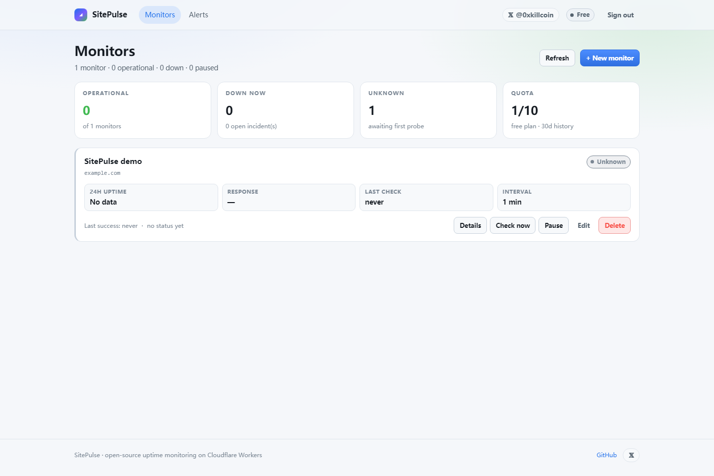
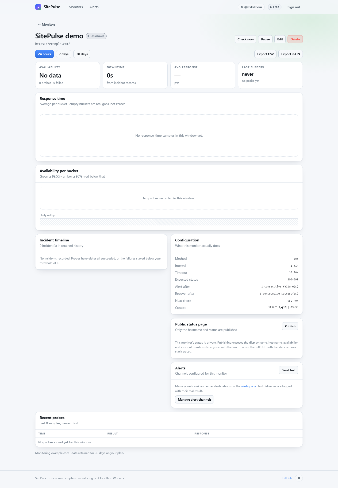
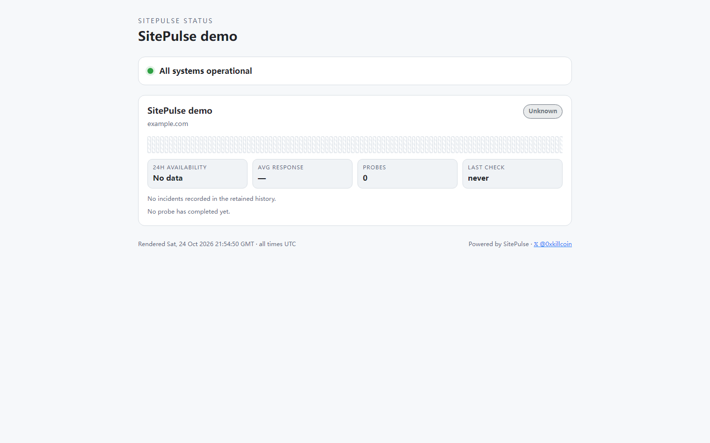
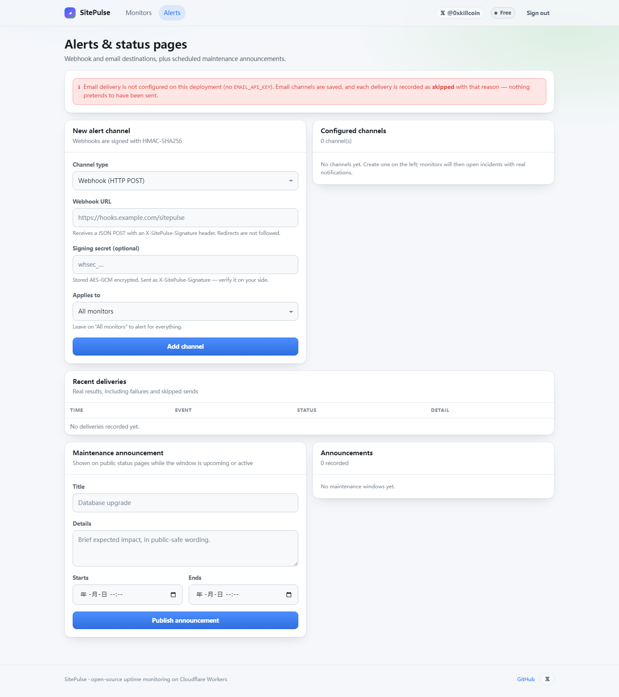
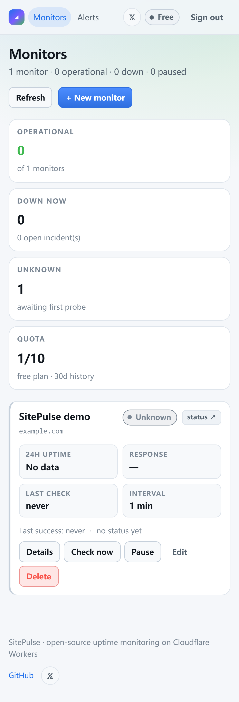
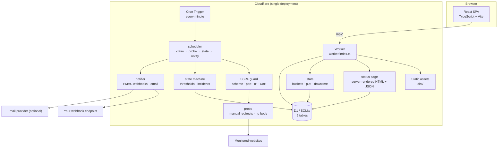
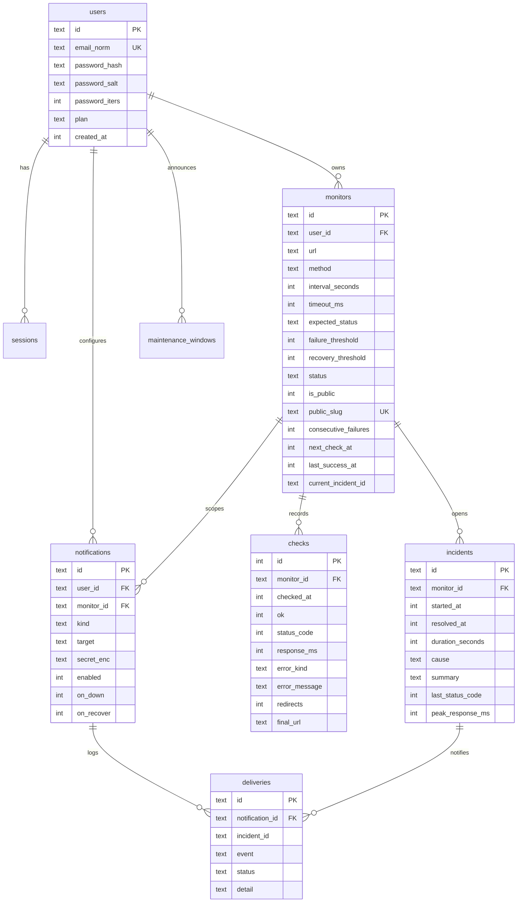

<div align="center">

# ◢ SitePulse

**A website heartbeat monitor that keeps beating after you close the tab.**

Probes your sites every minute from Cloudflare's edge, groups failures into
incidents with real durations, and publishes a status page you can share.

[](https://sitepulse.changyuansex.workers.dev)
[](#testing)
[](#testing)
[](LICENSE)
[](https://workers.cloudflare.com/)

[Live demo](https://sitepulse.changyuansex.workers.dev) ·
[Public status page](https://sitepulse.changyuansex.workers.dev/status/m-794da05b62f9) ·
[Security policy](SECURITY.md) ·
[Follow @0xkillcoin on 𝕏](https://x.com/0xkillcoin)

</div>

---

<div align="center">



<sub>The dashboard: per-monitor availability, last probe result and the live status pill. Data above is from a real deployment, not a mockup.</sub>

</div>

## Why this exists

Every uptime monitor tells you "your site is down". Almost none tell you *how
long it has been down*, *how many probes actually failed*, or *whether the last
failure was a 500 or a DNS black hole*. SitePulse is built around those
questions:

- **Incidents, not alerts.** A monitor only goes `down` after *N* consecutive
  failures (configurable, default 3). A single dropped packet never pages you.
- **Real durations.** Every incident stores `started_at`, `resolved_at` and
  `durationSeconds`. Recovery itself can require *N* consecutive successes.
- **Honest statistics.** Availability is `failed / total` over **stored** probes.
  Empty buckets are drawn as gaps. With no samples the UI prints **“No data”** —
  never a fake 100%.
- **Unknown ≠ Paused ≠ Down.** A monitor with no probe yet is `unknown`. A
  paused monitor is `paused`. Conflating them is how dashboards lie.
- **Runs without you.** Cloudflare Cron Triggers fire every minute whether or
  not any browser is open.

## Features

| | |
| --- | --- |
| **Monitors** | Name, URL, method (`GET`/`HEAD`), interval (60 s – 1 h), timeout (5–30 s), expected status (`200-299`, `200,204`, `301-302`, …), failure & recovery thresholds |
| **Probing** | HTTP(S) from Cloudflare's edge, manual redirect handling (max 5 hops), body never downloaded, per-probe hard deadline |
| **States** | `unknown`, `up`, `down`, `recovering`, `paused` — all distinct in the UI and the API |
| **History** | 24 h / 7 d / 30 d windows, response-time chart, availability-per-bucket chart, daily rollup strip, p95 latency |
| **Incidents** | Open/resolve automatically, store cause + last status code + peak latency, timeline view |
| **Notifications** | Webhook (HMAC-SHA256 signed, AES-GCM secrets at rest) and email. Every attempt is recorded with its real result — including `skipped` when no provider is configured |
| **Public status** | Server-rendered HTML *and* JSON feed, works without JS, hostname-only disclosure, maintenance announcements |
| **Operations** | Pause / resume / edit / delete, manual check with de-duplication, CSV & JSON export |
| **Quotas** | Per-plan monitor limits, minimum interval, retention window, rate limits on every mutating endpoint |

## Screenshots

<table>
<tr>
<td width="50%">

**Monitor detail — charts, config, incidents**


</td>
<td width="50%">

**Public status page — server-rendered**


</td>
</tr>
<tr>
<td width="50%">

**Alerts — webhook / email channels**


</td>
<td width="50%">

**iPhone 13 (390 px) — responsive dashboard**


</td>
</tr>
</table>

## Architecture



**Why the pieces are separate modules:** `urlguard` has no knowledge of HTTP,
`probe` has no knowledge of the database, `monitor-state` is a pure function
with no I/O, and `scheduler` is the only place that talks to D1 during a probe.
That is what makes the state machine and the guard unit-testable without a
network or a database.

### How a probe actually runs

```
Cron (* * * * *)
  └─ SELECT monitors WHERE enabled = 1 AND next_check_at <= now LIMIT 20
       └─ for each monitor:
            UPDATE monitors SET next_check_at = now + interval
              WHERE id = ? AND next_check_at = ?     ← atomic claim, dedupes overlapping runs
            probe(url, method, timeout)
              ├─ assertProbeableUrl()  → scheme / credentials / port / hostname / DoH
              ├─ fetch(redirect: 'manual')  → re-guard every hop, cancel body immediately
              └─ compare status against expectedStatus
            INSERT INTO checks (...)
            applyProbeOutcome()  → up / down / recovering, opens or closes an incident
            dispatchEvent()      → webhooks + email, deduped by (channel, incident, event)
```

The `next_check_at` write happens **before** the probe, so a crashed isolate
cannot cause a hot loop, and the conditional `UPDATE` means two overlapping cron
runs can never probe the same monitor for the same slot.

## Tech stack

| Layer | Choice | Why |
| --- | --- | --- |
| Frontend | React 18 + TypeScript + Vite 6 | Small bundle (63 kB gzip), no framework overhead |
| Styling | Hand-written CSS with custom properties | Dark/light via `prefers-color-scheme`, no CSS framework to audit |
| Charts | Hand-rolled SVG | Zero dependencies, and gaps in data stay visible |
| Backend | Cloudflare Workers | HTTP handling *and* cron *and* static assets in one deploy |
| Database | Cloudflare D1 (SQLite) | Relational modelling for incidents, no connection pooling |
| Scheduling | Cron Triggers (`* * * * *`) | Survives browser close, no external scheduler |
| Auth | Session cookies + PBKDF2 | No third-party identity provider required |
| Tests | Vitest + Playwright (chrome, via playwright-core) | Unit + real production E2E |

## Database schema

Nine tables; the full DDL lives in [`worker/schema.sql`](worker/schema.sql).



Key constraints that carry product meaning:

- `UNIQUE(monitors.public_slug)` — public URLs are unguessable and stable.
- `UNIQUE(deliveries.notification_id, incident_id, event)` — a duplicate cron
  run physically cannot send the same alert twice.
- `PRAGMA foreign_keys = ON` + `ON DELETE CASCADE` — deleting a monitor removes
  its checks, incidents, deliveries and scoped notification channels.

## API

All authenticated endpoints accept either the `sp_session` cookie or
`Authorization: Bearer <token>`. Errors are always
`{ "error": { "message": "...", "code": "..." } }`.

| Method | Path | Notes |
| --- | --- | --- |
| `POST` | `/api/auth/register` | 20/hour/IP, PBKDF2, returns a session cookie |
| `POST` | `/api/auth/login` | 40/10 min/IP + 10/10 min/account |
| `POST` | `/api/auth/logout` | Invalidates the server-side session |
| `GET` | `/api/auth/me` | Current user + quota usage |
| `GET` | `/api/account/summary` | Counts by status, open incidents, limits |
| `GET` `POST` | `/api/monitors` | List / create (quota + SSRF validated) |
| `GET` `PATCH` `DELETE` | `/api/monitors/:id` | Detail (with `?range=24h\|7d\|30d`) / update / delete |
| `POST` | `/api/monitors/:id/pause` · `/resume` | Lifecycle |
| `POST` | `/api/monitors/:id/check-now` | Queues a probe; 409 if one is already pending |
| `POST` | `/api/monitors/:id/test-notification` | Fires the real dispatch path |
| `GET` | `/api/monitors/:id/export?format=csv\|json&range=24h` | Download raw probes + incidents |
| `GET` | `/api/monitors/:id/incidents` | Timeline |
| `GET` `POST` | `/api/notifications` | List / create channels |
| `PATCH` `DELETE` | `/api/notifications/:id` | Update / delete |
| `POST` | `/api/notifications/:id/test` | Real delivery attempt |
| `GET` | `/api/notifications/:id/deliveries` | Delivery log |
| `GET` `POST` | `/api/maintenance` | Announcements shown on status pages |
| `DELETE` | `/api/maintenance/:id` | Remove |
| `GET` | `/status/:slug` | **Public** server-rendered status page |
| `GET` | `/api/status/:slug` | **Public** JSON feed, CORS-open |
| `GET` | `/healthz` | Liveness + D1 reachability |

### Webhook payload

```json
{
  "event": "down",
  "sentAt": "2026-10-25T05:12:00.000Z",
  "service": { "id": "mon_ab12", "name": "Marketing site", "url": "https://example.com" },
  "statusPage": "https://sitepulse.example.workers.dev/status/m-abc123",
  "monitorStatus": "down",
  "lastStatusCode": 503,
  "lastResponseMs": 4210,
  "consecutiveFailures": 3,
  "error": { "kind": "status", "label": "Unexpected HTTP status", "message": "Expected 200-299 but received 503." },
  "incident": {
    "id": "inc_9f2c",
    "startedAt": "2026-10-25T05:11:58.000Z",
    "resolvedAt": null,
    "durationSeconds": 2,
    "durationHuman": "2s",
    "cause": "status"
  }
}
```

Verify the signature on your side:

```js
import { createHmac, timingSafeEqual } from 'node:crypto';

const expected = createHmac('sha256', process.env.SITEPULSE_SECRET)
  .update(rawBody) // the exact bytes you received
  .digest('hex');
const received = req.headers['x-sitepulse-signature'];
const ok = received.length === expected.length &&
  timingSafeEqual(Buffer.from(received), Buffer.from(expected));
```

## Quick start

```bash
git clone https://github.com/iiiiiiiiiiiiiKK/sitepulse.git
cd sitepulse
npm install

# 1. create the D1 database and copy the id into wrangler.jsonc
npx wrangler d1 create sitepulse-db

# 2. apply the schema
npx wrangler d1 execute sitepulse-db --remote --file=worker/schema.sql

# 3. secrets (never commit these)
node -e "console.log(require('crypto').randomBytes(32).toString('base64'))" # ENCRYPTION_KEY
npx wrangler secret put ENCRYPTION_KEY
npx wrangler secret put AUTH_PEPPER
npx wrangler secret put PUBLIC_BASE_URL

# 4. build + deploy
npm run build
npx wrangler deploy
```

Local development:

```bash
cp .env.example .dev.vars   # fill ENCRYPTION_KEY and AUTH_PEPPER
npx wrangler d1 execute sitepulse-db --local --file=worker/schema.sql
npx wrangler dev --port 8788     # Worker + API on :8788
npm run dev                      # Vite dev server on :5173, proxies /api to :8788
```

The first account created on a fresh deployment is automatically upgraded to
the `pro` plan so you can try 50 monitors and 90-day retention immediately.

## Environment variables

| Name | Required | Purpose |
| --- | --- | --- |
| `ENCRYPTION_KEY` | for webhook secrets | 32 random bytes, base64. AES-256-GCM key for signing secrets at rest |
| `AUTH_PEPPER` | recommended | Extra PBKDF2 input. Setting it after users exist invalidates their passwords |
| `PUBLIC_BASE_URL` | recommended | Absolute base URL used in notification bodies |
| `EMAIL_API_KEY` | for email alerts | Resend-compatible bearer token |
| `EMAIL_FROM` | for email alerts | `SitePulse <alerts@yourdomain>` |
| `EMAIL_API_URL` | no | Defaults to `https://api.resend.com/emails` |
| `PROBES_PER_RUN` | no | Max monitors probed per cron tick (default 20, cap 50) |

See [`.env.example`](.env.example). Nothing in this table is committed with a
real value.

## Testing

```bash
npm test          # unit + integration (Vitest, 137 tests)
npm run typecheck # tsc over src/ and worker/
npm run build     # production build
```

Unit suites cover the parts where a bug would be invisible or dangerous:

| Suite | Tests | What it locks down |
| --- | --- | --- |
| `tests/urlguard.test.ts` | 49 | every private/link-local/metadata range, encoded IPv4, IPv6 forms, port allow-list, DNS rebinding, fail-closed behaviour |
| `tests/probe.test.ts` | 19 | 2xx/404/5xx classification, redirect re-validation, redirect limits, timeout/DNS/TLS/connection mapping, manual redirect mode |
| `tests/monitor-state.test.ts` | 22 | failure thresholds, recovery thresholds, flapping, paused isolation, availability maths, downtime clamping |
| `tests/stats.test.ts` | 11 | bucket gaps, p95, downtime clipping, daily rollups |
| `tests/crypto.test.ts` | 24 | PBKDF2 round-trip, pepper, AES-GCM envelope, HMAC, constant-time compare |
| `tests/privacy.test.ts` | 12 | status page never leaks paths/query/emails; webhook payload never leaks secrets |

### End-to-end against production

These scripts run against the **live deployment** with real HTTP, not mocks:

```bash
# 70 checks: auth, SSRF rejection, ownership isolation, real cron probes,
# incident creation, exports, status pages, webhooks, rate limits, headers
node e2e/production-check.mjs https://sitepulse.changyuansex.workers.dev

# 12 checks: incident opens → recovery threshold → incident closes with duration
node e2e/recovery-check.mjs  https://sitepulse.changyuansex.workers.dev

# 17 checks: desktop + iPhone 13 + 320px, overflow, tap targets, console errors;
# also writes the screenshots used in this README
node e2e/ui-check.mjs        https://sitepulse.changyuansex.workers.dev
```

Latest run against production:

| Suite | Result |
| --- | --- |
| Unit / integration | **137 / 137 passing** |
| Production API + cron E2E | **70 / 70 passing** |
| Recovery & incident lifecycle | **12 / 12 passing** |
| Browser UI (desktop + iPhone 13 + 320 px) | **17 / 17 passing** |

## Security

Read [`SECURITY.md`](SECURITY.md) for the full threat model. Highlights:

- **SSRF:** scheme/port/hostname/IP allow-lists plus a DNS-over-HTTPS
  resolution check; every redirect hop is re-validated; failures fail closed.
- **No port scanning:** only 80/443/8080/8443, and only `GET`/`HEAD`.
- **Secrets:** PBKDF2 passwords, hashed session tokens, AES-GCM webhook secrets,
  no secret ever returned by the API or written to a log.
- **Tenant isolation:** every query is `user_id`-scoped; foreign resources 404.
- **Rate limits:** sign-up, sign-in, monitor creation, manual checks and test
  notifications are all bounded per IP/account.
- **Security headers:** `nosniff`, `DENY` framing, HSTS, referrer policy and a
  restrictive permissions policy are applied to every response.

## Deploying elsewhere

The Worker needs three primitives: a D1 binding, a cron trigger and static
assets. Any platform with those works; the mapping is:

| SitePulse needs | Cloudflare | Vercel equivalent | Notes |
| --- | --- | --- | --- |
| Scheduled probe | Cron Trigger | Cron Job (`vercel.json`) | Vercel Hobby allows 2 cron jobs, **once per day** — not viable for a 60 s monitor; Pro allows 40/min |
| Database | D1 | Postgres/Neon | Schema is SQLite-flavoured; needs a driver swap |
| Static assets | Worker assets | `vercel static` | Any static host works |
| Long-running probe | Worker fetch | Serverless function | 10 s default timeout on Hobby |

**Conclusion:** Cloudflare is the right host for this project because a
1-minute cadence is impossible on Vercel Hobby. GitHub Pages cannot host it at
all: it is static-only with no cron, no database and no server-side secrets, so
the probe scheduler and the public status pages would not exist.

## Showcase material

Ready-to-post copy and the screenshot index live in [docs/SHOWCASE.md](docs/SHOWCASE.md).

## Known limitations

Honest list — these are real, not hypothetical:

1. **Probe origin is single-region.** Cloudflare runs the cron in one location,
   so a geographically local outage may be attributed to your site. Multi-region
   probing needs a Queues + Durable Object fan-out and is not implemented.
2. **DNS rebinding is mitigated, not eliminated.** Workers cannot pin the IP
   that `fetch` uses (see SECURITY.md §1).
3. **Email requires an external provider.** Without `EMAIL_API_KEY`, email
   channels are stored and deliveries are logged as `skipped` — never as sent.
4. **No alert retry queue.** A webhook gets one retry and is then recorded as
   `failed`; there is no exponential backoff schedule beyond that.
5. **No team accounts.** One user per account; no sharing or roles.
6. **D1 write throughput.** Each probe is one write. With a 60 s cadence and
   dozens of monitors this stays well inside D1's limits, but a very large
   deployment would need batching.
7. **`pro` plan is a flag, not a billing integration.** There is no payment
   flow; the first account on a fresh install is promoted automatically.
8. **Charts are SVG, not canvas.** Fine up to ~120 buckets; a 5-year view would
   need aggregation at the SQL layer.

## Roadmap

- [ ] Multi-region probe fan-out (Queues + Durable Objects)
- [ ] Alert retry queue with exponential backoff
- [ ] TCP / TLS-certificate-expiry / keyword-in-body checks
- [ ] Team accounts and read-only API tokens
- [ ] Scheduled report emails (weekly availability digest)

## Contributing

1. Fork, branch from `main`, `npm install`.
2. `npm run typecheck && npm test` must pass before you open a PR.
3. Keep the SSRF guard and the state machine pure and covered by tests — PRs
   that weaken either will be rejected.
4. Screenshots in PRs must come from a real running instance.

## License

[MIT](LICENSE) © 2026 SitePulse contributors

---

<div align="center">

Built and maintained by **[@0xkillcoin](https://x.com/0xkillcoin)** on 𝕏

If SitePulse saved you an outage, a ⭐ helps more people find it.

</div>
